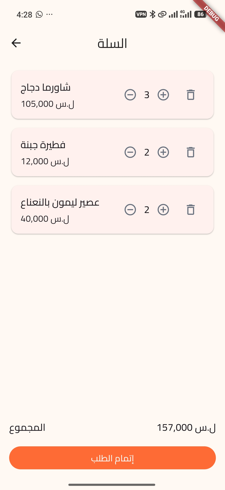
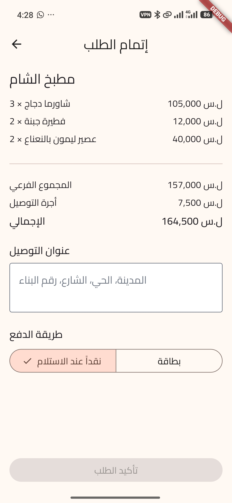
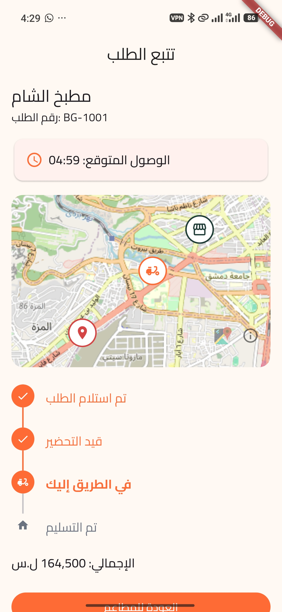
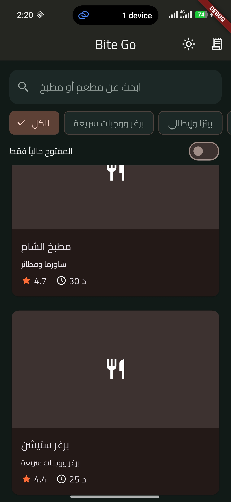

<div dir="rtl">

# Bite Go 🍔

تطبيق توصيل طعام مبني بـ **Flutter**: تصفّح المطاعم، اطلب من المنيو، وتابع طلبك على الخريطة.

> مشروع شخصي ضمن الـ portfolio. يعمل على **طبقة بيانات وهمية** (لا يوجد back-end حقيقي بعد)، وقد صُمّم بحيث يمكن استبدالها بـ REST API حقيقي دون المساس بالواجهة.

[English](README.md)

## لقطات الشاشة

| المطاعم | المنيو | السلة |
|:---:|:---:|:---:|
|  |  |  |

| إتمام الطلب | تتبع الطلب | سجل الطلبات |
|:---:|:---:|:---:|
|  |  |  |

| الوضع الداكن | البحث والفلترة | المفضلة |
|:---:|:---:|:---:|
|  |  |  |

## الميزات

- **قائمة المطاعم** مع بحث متأخر (debounce)، وفلترة بالمطبخ، ومفتاح "المفتوح حالياً فقط"، والمفضلة
- **تفاصيل المطعم** مع المنيو مقسّماً بالفئات (المطعم المغلق يمكن تصفّحه دون الطلب منه)
- **سلة** من مطعم واحد فقط، مع حوار تأكيد عند التبديل بين المطاعم
- **إتمام الطلب** بعنوان التوصيل وطريقة الدفع (نقداً / بطاقة)
- **تتبع الطلب**: خط زمني للمراحل (تم الاستلام ← قيد التحضير ← في الطريق ← تم التسليم)، والوقت المتوقع للوصول، وخريطة بعلامة سائق متحركة (OpenStreetMap بدون مفتاح API)
- **سجل الطلبات**
- **وضع فاتح وداكن** مع زر تبديل
- الأسعار بالليرة السورية (ل.س)، وواجهة عربية بخط **Cairo** مضمَّن في التطبيق
- اختبارات unit وwidget (للـ cubits والـ blocs والـ repositories والصفحات)

## التقنيات

| المجال | المستخدم |
|---|---|
| الإطار | Flutter 3 / Dart 3 |
| إدارة الحالة | `flutter_bloc` (Cubit للحالات البسيطة وBloc كامل بالـ events للبحث) + `equatable` |
| التنقل | `go_router` (الـ id في المسار فتعمل الروابط العميقة) |
| الخريطة | `flutter_map` + `latlong2` (OpenStreetMap) |
| الـ Streams | `stream_transform` (debounce و`switchMap` للبحث) |

## المعمارية

مجلدات حسب الميزة (feature-first)، وفي كل ميزة ثلاث طبقات:

```
lib/
├── core/                  # الثيم، الراوتر، widgets مشتركة، أدوات
└── features/
    ├── restaurants/       # domain / data / presentation
    ├── cart/
    ├── tracking/
    └── favorites/
```

- **domain**: الـ entities وواجهات الـ repository (Dart خالص لا يعرف شيئاً عن الواجهة أو الشبكة)
- **data**: تنفيذ الـ repositories. حالياً كلاسات `Fake*Repository` مع تأخير محاكى، ويحلّ محلها API حقيقي دون تغيير الطبقات الأعلى
- **presentation**: الصفحات والـ widgets والـ Cubits/Blocs. كل صفحة مقسومة إلى `Page` (توفّر الـ Cubit) و`View` (ترسم الحالة)
- حالات الواجهة `sealed` classes (تحميل / نجاح / خطأ)، فيُجبر المترجم على تغطية كل الحالات
- القيم المشتقة (المجاميع، القوائم المفلترة) تُحسب بـ getters ولا تُخزَّن بجانب مصدرها

## التشغيل

```bash
git clone https://github.com/HamzaLM10/bite_go.git
cd bite_go
flutter pub get
flutter run
```

تشغيل الاختبارات:

```bash
flutter test
```

## حدود معروفة

مذكورة عمداً ليعرف القارئ ما هو حقيقي وما هو محاكى:

- **لا يوجد back-end حقيقي.** المطاعم والطلبات من repositories وهمية في الذاكرة.
- **لا شيء يُحفظ بين مرات التشغيل.** السلة واختيار الثيم والمفضلة وسجل الطلبات في الذاكرة فقط.
- **التتبع محاكى.** حالة الطلب تتقدّم بمؤقّت داخل الـ repository الوهمي، وموقع السائق مشتق من الحالة وليس من GPS حقيقي.
- **الأسعار `double`** للبساطة. في تطبيق حقيقي يُخزَّن المال بأصغر وحدة كعدد صحيح.
- النصوص مكتوبة مباشرة في الـ widgets، وتعريب الواجهة (عربي/إنجليزي مع RTL) مخطط له.
- صور المطاعم تُحمَّل من الإنترنت وتظهر أيقونة بديلة عند عدم الاتصال.

## الخطوات القادمة

- تسجيل دخول (مصادقة وهمية مع حماية المسارات)
- زر المفضلة في صفحة تفاصيل المطعم
- تعريب عربي/إنجليزي مع RTL
- حفظ محلي للسلة والثيم والمفضلة
- ربط بـ API حقيقي (REST أو Firebase)

## المطوّر

**حمزة عفيف**، مطوّر Flutter، دمشق
GitHub: [@HamzaLM10](https://github.com/HamzaLM10)

</div>
